# Informe técnico — Guía‑Taller No. 2 (versión 2)
## Mecanismos de seguridad para redes IEEE 802.3 con servidores TCP/IP

**Universidad Distrital Francisco José de Caldas · Ingeniería de Sistemas**
**Docente:** Octavio José Salcedo Parra
**Fecha de asignación:** 26 de octubre de 2026 · **Fecha de entrega:** 14 de noviembre de 2026

---

# Resumen ejecutivo

Este informe desarrolla la Guía‑Taller No. 2: diez casos de análisis de seguridad sobre una LAN Ethernet IEEE 802.3 con servicios TCP/IP (Parte I) y un sistema de rastreo de ubicación basado en consentimiento (Parte II).

Siguiendo las reglas de la guía, **no se generó tráfico de ataque contra ningún sistema**. Los casos se trabajaron con tres tipos de evidencia, que el informe distingue en todo momento:

| Etiqueta | Qué es | Dónde se usa |
|---|---|---|
| <span class="tag real">REAL</span> | Salida de comandos y programas ejecutados de verdad: `netstat -ano` y estado del firewall del equipo analista, scripts de análisis sobre las PCAP, entrenamiento del modelo de ML, pruebas de la API de la Parte II. | Casos 1, 2, 3, 4, 5, 7, 8 y Parte II |
| <span class="tag pcap">PCAP SINTÉTICA</span> | Capturas generadas con Scapy (`generar_evidencias.py`) con direcciones privadas de la topología de la guía. Los paquetes son sintéticos; las métricas que se reportan se **midieron** sobre esos archivos. | Casos 1, 2, 5, 7 y 8 |
| <span class="tag sim">ESCENARIO SIMULADO</span> | Telemetría didáctica (inventarios, logs, configuraciones) redactada para el caso, sin un servidor real detrás. Sirve para razonar indicadores y controles, no como prueba de un hecho. | Casos 3, 6, 9 y 10 |

**Hallazgos principales**

| # | Caso | Severidad | Hallazgo medido o planteado | Control prioritario |
|---|---|---|---|---|
| 1 | TCP SYN Flood | Alta | 3 847 SYN en 9,9 s desde 3 752 IP distintas; 42 SYN/ACK y ningún handshake completo | SYN cookies y límite de tasa perimetral |
| 2 | DNS tunneling | Alta | 847 consultas TXT en 122 s; etiquetas de 36–38 caracteres que decodifican como Base64 | Registro de consultas y resolver único autorizado |
| 3 | Servicios expuestos | Alta | Escenario con FTP/Telnet en claro; en el equipo real, 16 puertos TCP en escucha en todas las interfaces | Deshabilitar lo innecesario; cifrar; ligar a loopback |
| 4 | Anomalías con IA/ML | Media | Isolation Forest: precisión 0,97 y recall 0,95; la línea base estadística detecta todo pero con 6 veces más falsos positivos | Usar el score solo para priorizar revisión humana |
| 5 | TCP RST inesperados | Media | 234 sesiones cortadas con RST a los 28–30 s de inactividad, emitidos por el gateway | Ajustar timeout de estado; keep‑alive |
| 6 | Reflexión/amplificación UDP | Alta | Resolver abierto y `monlist` habilitado en el escenario | Restringir recursión, RRL, BCP 38 |
| 7 | ICMP atípico | Media | 3 375 Echo Request de 1 472 bytes en 7,5 min, sin respuestas; relleno incremental, no cifrado | Límite de tasa y de tamaño ICMP |
| 8 | Escaneo de puertos | Media | 65 535 puertos sondeados en 29,95 s; 7 respondieron SYN/ACK | Reducir superficie; alerta por puertos distintos |
| 9 | Correlación con SIEM/IA | Media | 2 309 alertas brutas reducidas a 23 incidentes en el escenario | Pipeline con validación humana registrada |
| 10 | XMPP y TLS | Alta | TLS 1.0, certificado vencido y consola de administración sin cifrar en el escenario | TLS 1.2+ obligatorio, certificado válido |

**Límites de la evidencia.** Una PCAP sintética demuestra que el método de análisis funciona y que los indicadores se saben medir; no demuestra que un ataque haya ocurrido. Tres afirmaciones de la versión anterior de este informe se corrigieron porque las capturas no las sostenían: la entropía "de contenido cifrado" del Caso 7, los 39 puertos abiertos y la huella de sistema operativo del Caso 8, y los RST "a 0,3–0,7 ms del último dato" del Caso 5.

# Alcance, topología y método

## Topología de referencia

Las direcciones corresponden a la topología sugerida por la guía. **No se desplegaron máquinas virtuales**: la red 192.168.50.0/24 existe únicamente dentro de las PCAP sintéticas y de los escenarios simulados.

| Elemento | Dirección | Papel en los casos |
|---|---|---|
| Equipo analista | 192.168.50.10/24 | Origen de consultas DNS (Caso 2) y de sesiones HTTPS (Caso 5) |
| Servidor web/pruebas | 192.168.50.20/24 | Destino del SYN flood, del ICMP y del escaneo (Casos 1, 7, 8) |
| Servidor DNS de laboratorio | 192.168.50.53/24 | Resolver de `lab.internal` (Casos 2 y 6) |
| Servidor de mensajería | 192.168.50.30/24 | XMPP (Caso 10) |
| Gateway de laboratorio | 192.168.50.1/24 | Emisor de los RST (Caso 5) |
| Host no inventariado | 192.168.50.100 | Origen del ICMP y del escaneo (Casos 7 y 8) |

El único equipo físico utilizado es el computador del analista (Windows, `netstat -ano` capturado el 2026‑11‑16 21:43, UTC‑5), que aporta la evidencia real del Caso 3.

## Herramientas

| Herramienta | Uso | Tipo de evidencia |
|---|---|---|
| Python 3 + Scapy | Generación de las cinco PCAP (`generar_evidencias.py`) | PCAP sintética |
| `analizar_pcaps.py` (biblioteca estándar de Python) | Lectura de las PCAP, conteos, entropía, tablas de flujos y SHA‑256 | Real |
| Wireshark | Los filtros de visualización que se citan en cada caso reproducen los mismos conteos al abrir la PCAP | Reproducible |
| `netstat -ano`, `netsh`, PowerShell | Inventario de puertos y estado del firewall del equipo analista | Real |
| scikit‑learn (Isolation Forest), NumPy, pandas | Caso 4 | Real sobre datos sintéticos |
| FastAPI, SQLite, Leaflet, python‑telegram‑bot | Parte II | Real |

Las reglas de Suricata y Zeek son **propuestas**: se redactaron y justificaron, pero no se desplegó un sensor, tal como lo permite la guía.

## Método y reproducibilidad

1. Cada PCAP se conserva sin modificar en `evidencias/` y se identifica por su SHA‑256 (índice al final).
2. `python analizar_pcaps.py casoN` vuelve a calcular todas las cifras de este informe a partir del archivo; las capturas de consola que aparecen en cada caso son la salida de ese comando.
3. Los tiempos de las PCAP son relativos al primer paquete (t = 0 s), porque el generador no les asignó fecha de calendario.
4. Para cada hallazgo se registran observación, hipótesis principal, alternativas benignas, validación, severidad, acción e integridad, según el formato de la sección 7 de la guía.

# Parte I — Casos críticos

## Caso 1 — TCP SYN Flood: indisponibilidad y agotamiento de conexiones

<span class="tag pcap">PCAP SINTÉTICA</span> <span class="tag real">ANÁLISIS REAL</span>

| Campo | Registro |
|---|---|
| **Identificador** | CASO‑01‑EV‑001 |
| **Fecha/hora** | Tiempo relativo de la PCAP: t = 0 a 9,94 s. Archivo generado el 2026‑11‑16 (UTC‑5) |
| **Origen/destino** | 3 752 direcciones 10.0.0.0/16 → 192.168.50.20:80/TCP |
| **Observación** | 3 847 segmentos SYN sin ACK en 9,94 s (387 SYN/s). El servidor emite 42 SYN/ACK. No hay ningún ACK final: cero handshakes completos |
| **Hipótesis** | Inundación SYN con direcciones de origen falsificadas |
| **Alternativas benignas** | Pico legítimo de clientes (flash crowd), prueba de carga autorizada, clientes detrás de un balanceador que reintentan |
| **Validación** | `tcp.flags.syn == 1 && tcp.flags.ack == 0` → 3 847 paquetes. 97,5 % de las IP envía un solo SYN; TTL entre 48 y 127; ningún SYN lleva opciones TCP |
| **Severidad** | Alta: impacto directo en disponibilidad; probabilidad alta en servicios expuestos |
| **Acción** | SYN cookies en el servidor y límite de tasa en el gateway; responsable: administrador de infraestructura; verificar que clientes legítimos sigan conectando |
| **Integridad** | `caso1_synflood_lab.pcap` · 272 254 bytes · SHA‑256 `a28678760a655d13945d1588ac033784193b2fca43c886bf448af85eb6d31950` |

### Procedimiento y evidencia

```
tcp.flags.syn == 1 && tcp.flags.ack == 0          SYN de apertura
tcp.flags.syn == 1 && tcp.flags.ack == 1          SYN/ACK del servidor
tcp.flags == 0x010 && tcp.len == 0                ACK que cierra el handshake
Statistics > I/O Graphs, intervalo 1 s            gráfica temporal
Statistics > Endpoints > IPv4                     número de orígenes
```


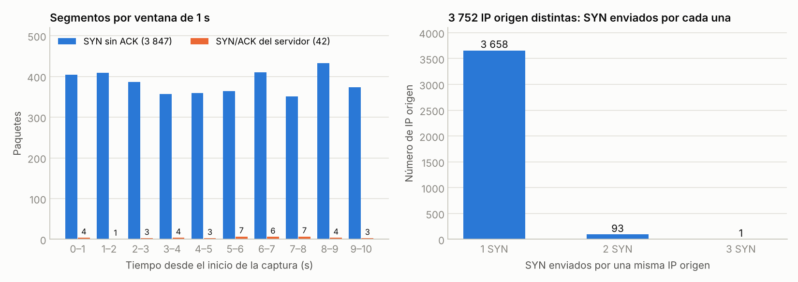

Tres rasgos sostienen la hipótesis de tráfico fabricado y no de clientes reales:

- **Ningún handshake termina.** Un pico legítimo produce SYN, pero también ACK finales y datos HTTP. Aquí la relación SYN : SYN/ACK es 91,6 : 1 y la de handshakes completos es cero.
- **Orígenes de un solo uso.** 3 658 de 3 752 direcciones aparecen una única vez. Los clientes reales retransmiten el SYN cuando no reciben respuesta.
- **SYN sin opciones TCP.** Los sistemas operativos actuales anuncian MSS, SACK y escala de ventana en el SYN; estos paquetes no traen ninguna opción y todos usan ventana 8192, lo que apunta a una herramienta que construye paquetes.

**Línea base de comparación** <span class="tag real">REAL</span>. En el equipo analista, `netstat -ano` registró 40 sockets en `LISTENING`, 34 `ESTABLISHED` y **0 en `SYN_RECEIVED`** (figura del Caso 3). En un servidor bajo SYN flood esa última cifra crece hasta el tamaño de la cola de conexiones pendientes; es el dato que debe vigilarse con:

```powershell
netstat -ano | Select-String "SYN_RECEIVED" | Measure-Object | Select-Object Count
Get-NetTCPConnection -State SynReceived | Group-Object RemoteAddress | Sort-Object Count -Descending
```

### Regla de detección propuesta (Suricata)

```
alert tcp any any -> 192.168.50.20 80 (msg:"LAB-01 Posible SYN flood hacia servidor web";
    flags:S,12; flow:stateless;
    threshold:type both, track by_dst, count 300, seconds 5;
    classtype:attempted-dos; sid:9000001; rev:2;)
```

El umbral (300 SYN en 5 s hacia un mismo destino) queda por debajo de los 1 900 SYN por cada 5 s medidos en la captura y muy por encima de la carga normal de un servidor de laboratorio. Debe recalibrarse con la línea base real del servicio.

### Mitigación

| Control | Tipo | Cómo se verifica |
|---|---|---|
| SYN cookies (`net.ipv4.tcp_syncookies=1`; en Windows, protección SYN del stack TCP/IP activa por defecto) | Preventivo | La cola de pendientes deja de saturarse durante una prueba de carga autorizada |
| Límite de tasa por origen y `synproxy` en el gateway | Preventivo | Contadores del firewall; clientes legítimos mantienen el servicio |
| Alerta LAB‑01 | Detectivo | La regla se dispara con la PCAP del caso y no con tráfico normal |
| Escalamiento al proveedor para filtrado aguas arriba | Correctivo | Procedimiento documentado y contacto vigente |

La comparación antes/después con SYN cookies queda como verificación pendiente: requiere un servidor real y una prueba de carga autorizada, que no se ejecutó en este taller.

### Preguntas de análisis

**¿Qué recursos mantiene el servidor durante el handshake TCP?** Por cada SYN aceptado, el núcleo crea una entrada en la cola de conexiones incompletas (estado `SYN_RECEIVED`) con las direcciones, puertos, números de secuencia iniciales y opciones negociadas, y arma un temporizador para retransmitir el SYN/ACK varias veces. La entrada se libera cuando llega el ACK final o cuando vencen los reintentos (del orden de un minuto). La cola tiene tamaño finito (`tcp_max_syn_backlog`, `somaxconn`): cuando se llena, los SYN nuevos se descartan aunque el servidor tenga CPU y memoria libres.

**¿Qué falsos positivos pueden producir picos legítimos?** Lanzamientos o eventos con muchos clientes simultáneos, pruebas de carga autorizadas, monitoreo sintético, reconexión masiva tras una caída y clientes detrás de un NAT o balanceador que concentran muchos SYN en una sola IP. Se distinguen porque en ellos sí hay handshakes completos, tráfico de aplicación y orígenes que se repiten.

## Caso 2 — DNS tunneling: posible salida encubierta mediante UDP/53

<span class="tag pcap">PCAP SINTÉTICA</span> <span class="tag real">ANÁLISIS REAL</span>

| Campo | Registro |
|---|---|
| **Identificador** | CASO‑02‑EV‑001 |
| **Fecha/hora** | Tiempo relativo de la PCAP: t = 0 a 121,65 s. Archivo generado el 2026‑11‑16 (UTC‑5) |
| **Origen/destino** | 192.168.50.10 (puertos efímeros) → 192.168.50.53:53/UDP |
| **Observación** | 847 consultas, todas de tipo TXT y todas bajo `exfil-test.lab.internal`; 6,96 consultas/s (418 por minuto). La primera etiqueta mide 36–38 caracteres y tiene entropía media de 4,35 bits/carácter |
| **Hipótesis** | Canal encubierto: datos codificados en Base64 dentro del subdominio |
| **Alternativas benignas** | Telemetría de software, tokens de CDN o antivirus que usan DNS, validaciones tipo DKIM/ACME (TXT), cliente mal configurado |
| **Validación** | `dns.qry.type == 16` → 847. Al decodificar la etiqueta como Base64 se obtiene texto legible más un byte contador |
| **Severidad** | Alta: posible exfiltración o canal de mando y control |
| **Acción** | Identificar el proceso en 192.168.50.10 antes de bloquear; registrar consultas en el resolver; impedir DNS directo hacia fuera |
| **Integridad** | `caso2_dnstunnel_lab.pcap` · 115 640 bytes · SHA‑256 `df946077e9557e9255c5b36b5f48d56dc203e542d488b1e1a107e529fbdb97f6` |

### Procedimiento y evidencia

```
udp.port == 53                                    todo el tráfico DNS
dns.flags.response == 0 && dns.qry.type == 16     consultas TXT
dns.qry.name.len > 50                             nombres largos
dns.qry.name contains "exfil-test"                dominio base
Statistics > DNS                                  tipos de consulta y tasas
```


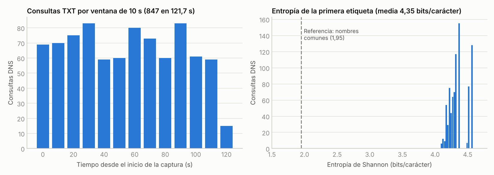

**Tabla por host y dominio**

| Cliente | Dominio base | Consultas | Tipo | Etiquetas distintas | Longitud media | Entropía media |
|---|---|---|---|---|---|---|
| 192.168.50.10 | exfil-test.lab.internal | 847 | TXT (100 %) | 256 | 36,5 | 4,35 bits/carácter |

La decodificación confirma el mecanismo: `dGhpcyBpcyB0ZXN0IGRhdGEgY2h1bmsgMDAxAA` es «this is test data chunk 001» seguido de un byte que se incrementa en cada consulta (por eso solo hay 256 etiquetas distintas). La captura no contiene respuestas, de modo que no puede afirmarse nada sobre el canal de retorno ni sobre TTL.

### Reglas de detección propuestas

```
alert dns any any -> any 53 (msg:"LAB-02 DNS etiqueta larga tipo Base64";
    dns.query; pcre:"/^[A-Za-z0-9+\/_-]{30,}\./";
    threshold:type both, track by_src, count 30, seconds 60;
    classtype:policy-violation; sid:9000002; rev:2;)
```

```zeek
redef enum Notice::Type += { DNS_Etiqueta_Larga };

event dns_request(c: connection, msg: dns_msg, query: string, qtype: count, qclass: count)
    {
    local etiquetas = split_string(query, /\./);
    if ( |etiquetas| > 0 && |etiquetas[0]| >= 30 )
        NOTICE([$note=DNS_Etiqueta_Larga, $conn=c,
                $msg=fmt("Etiqueta DNS de %d caracteres: %s", |etiquetas[0]|, query),
                $identifier=cat(c$id$orig_h)]);
    }
```

La regla combina forma (30 o más caracteres del alfabeto Base64) y volumen (30 por minuto por cliente): cualquiera de las dos condiciones por separado produce falsos positivos con CDN y telemetría.

### Mitigación

- Forzar que todos los equipos resuelvan únicamente contra 192.168.50.53 y bloquear en el gateway UDP/TCP 53, DoT (853) y DoH conocidos hacia cualquier otro destino.
- Activar el registro de consultas (`querylog yes;` en BIND 9) y conservarlo para correlación.
- Aplicar política de respuesta (RPZ) o listas de dominios para el dominio confirmado.
- Investigar el host: `Get-NetUDPEndpoint` y `Get-Process -Id <PID>` para ubicar el proceso que genera las consultas. Bloquear solo después de descartar software legítimo.

### Preguntas de análisis

**¿Por qué el carácter sin conexión de UDP no significa que todo DNS sea malicioso?** UDP es el transporte normal de DNS desde su diseño: una consulta y una respuesta caben en un datagrama y no necesitan estado. Que no haya conexión solo implica que no existe un handshake que observar; no dice nada sobre la intención. Lo anómalo de este caso no es el protocolo, sino el contenido y el comportamiento de las consultas.

**¿Qué atributos ayudan a distinguir una anomalía?** Longitud de la etiqueta y del nombre completo; entropía de la etiqueta; proporción de tipos poco frecuentes (TXT, NULL); número de subdominios distintos bajo un mismo dominio base; tasa de consultas por cliente; proporción de respuestas NXDOMAIN; antigüedad y reputación del dominio; y si el cliente usa el resolver autorizado. Ningún atributo basta por sí solo: los valores medidos aquí (36 caracteres, 4,35 bits/carácter, 418 consultas/min, 100 % TXT, un solo dominio) coinciden todos a la vez.

## Caso 3 — Exposición de servicios HTTP, FTP y otros servicios heredados

Este caso tiene dos partes: un inventario **real** del equipo propio y un **escenario simulado** de servidor heredado.

### 3.1 Inventario real del equipo analista

<span class="tag real">REAL</span>

| Campo | Registro |
|---|---|
| **Identificador** | CASO‑03‑EV‑001 |
| **Fecha/hora** | 2026‑11‑16 21:43:31 (UTC‑5), reloj del equipo |
| **Origen/destino** | Equipo analista «Cris», Windows 10.0.26300; sockets locales |
| **Observación** | 40 sockets TCP en `LISTENING`; 16 puertos escuchan en `0.0.0.0` (todas las interfaces). Firewall de Windows activo en los tres perfiles |
| **Hipótesis** | Configuración por defecto de Windows más servicios instalados para desarrollo que escuchan en todas las interfaces sin necesitarlo |
| **Alternativas benignas** | Todos los puertos pueden corresponder a software legítimo; estar en escucha no implica ser alcanzable si el firewall filtra la entrada |
| **Validación** | `netstat -ano` y `netsh advfirewall show allprofiles state`, guardados en `sistema_netstat.txt` |
| **Severidad** | Media: exposición sin vulnerabilidad confirmada |
| **Acción** | Identificar el proceso de cada PID, ligar a 127.0.0.1 lo que solo se usa localmente y revisar reglas de entrada |
| **Integridad** | `sistema_netstat.txt` · 12 812 bytes · SHA‑256 `d534d1689ed80d315c102e797ef7d49d0a6b16022ea7ec2bf30762094594a586` |


**Inventario y prioridad**

| Puerto | PID | Servicio habitual del puerto | Necesidad | Prioridad y acción |
|---|---|---|---|---|
| 5432 | 7956 | PostgreSQL | Desarrollo local | **Alta.** Base de datos escuchando en todas las interfaces: fijar `listen_addresses = 'localhost'` |
| 445 | 4 | SMB (compartir archivos) | Solo si se comparten carpetas | **Media.** Mantener bloqueado en perfil público; deshabilitar si no se usa |
| 135, 49664–49672 | varios | RPC de Windows y puertos dinámicos | Sistema operativo | Baja. No exponer fuera de la red local |
| 2179 | 3032 | Hyper‑V (consola de máquinas virtuales) | Virtualización | Baja. Restringir a administradores |
| 7680 | 3668 | Optimización de distribución (Windows Update) | Opcional | Baja. Puede desactivarse el intercambio en LAN |
| 5040 | 7360 | Servicio de Windows (CDPSvc) | Sistema operativo | Baja |
| 1462, 1487 | 4 | Proceso System (controlador en modo núcleo) | Por confirmar | Media. Identificar el componente |
| 23130, 23132 | 11904 | No estándar | Por confirmar | **Media.** Identificar la aplicación |

El servicio se infiere del número de puerto. Para confirmarlo hay que resolver cada PID:

```powershell
Get-NetTCPConnection -State Listen | Select-Object LocalAddress, LocalPort, OwningProcess,
    @{n="Proceso";e={(Get-Process -Id $_.OwningProcess).ProcessName}} | Sort-Object LocalPort
```

### 3.2 Escenario simulado: servidor heredado 192.168.50.20

<span class="tag sim">ESCENARIO SIMULADO</span>

Inventario didáctico de un servidor con servicios heredados. Las versiones se eligieron porque tienen vulnerabilidades públicas bien documentadas.

| Puerto | Servicio y versión | Necesidad operativa | Cifrado | Riesgo |
|---|---|---|---|---|
| 21/tcp | vsftpd 2.3.4 | No documentada | Ninguno | **Crítico.** CVE‑2011‑2523 (puerta trasera); credenciales en claro |
| 23/tcp | telnetd | No | Ninguno | **Alto.** Sesión completa en claro |
| 22/tcp | OpenSSH 9.6 | Sí, administración | SSH | Bajo |
| 80/tcp | Apache 2.4.49 | Sí, web de laboratorio | Ninguno | **Alto.** CVE‑2021‑41773 (path traversal) |
| 443/tcp | Apache 2.4.49 | Sí | TLS 1.2/1.3 | Medio. Misma versión vulnerable |
| 3306/tcp | MySQL 8.0.32 | Solo interna | Ninguno | **Alto.** Accesible desde toda la LAN |
| 8080/tcp | Tomcat 9.0.70 | No documentada | Ninguno | **Alto.** Consola de administración sin autenticación |
| 445/tcp | Samba 4.17 | No | Firma SMB | Medio. Revisar recursos compartidos |

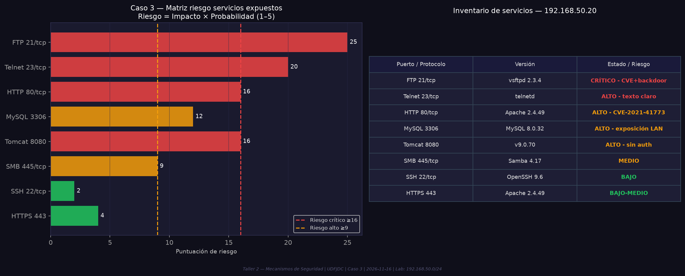

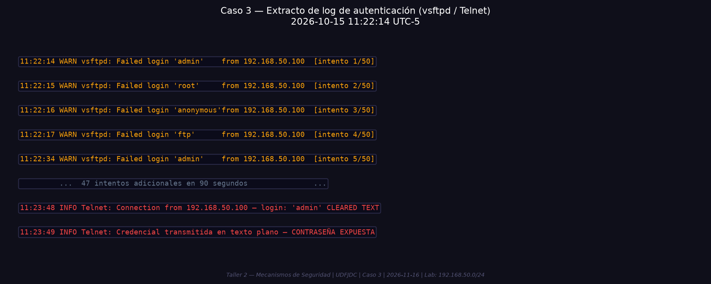

**Plan de remediación**

| Plazo | Acción | Verificación |
|---|---|---|
| Inmediato | Detener y deshabilitar FTP, Telnet y Tomcat 8080 | `netstat -ano` ya no muestra 21, 23 ni 8080 en escucha |
| Inmediato | MySQL ligado a 127.0.0.1 | Conexión desde otro host rechazada |
| 24 h | Actualizar Apache a la versión estable vigente y redirigir HTTP a HTTPS | Cabecera `Server` y prueba de redirección |
| 1 semana | Transferencia de archivos por SFTP con llaves; MFA para administración; cuentas de mínimo privilegio | Revisión de cuentas y de `sshd_config` |
| Continuo | Bloqueo temporal tras intentos fallidos repetidos y alerta al SIEM | Prueba controlada de intentos fallidos |

### Preguntas de análisis

**¿Cómo se prioriza un puerto abierto?** Con cuatro preguntas en orden: ¿alguien lo necesita? (si no, se cierra sin más análisis); ¿desde dónde es alcanzable? (loopback, LAN, Internet); ¿qué tan explotable es? (versión con CVE, texto claro, sin autenticación, credenciales por defecto); y ¿qué protege? (criticidad del dato o del servicio). En el inventario real, PostgreSQL en `0.0.0.0` queda primero porque combina datos, alcance de red y ninguna necesidad de escuchar fuera de loopback.

**¿Qué diferencia hay entre exposición, vulnerabilidad y explotación?** *Exposición* es que el servicio sea alcanzable desde una red. *Vulnerabilidad* es una debilidad concreta en ese servicio o en su configuración. *Explotación* es el uso efectivo de esa debilidad. El inventario real muestra exposición sin vulnerabilidad confirmada; el escenario simulado muestra exposición con vulnerabilidades conocidas; en ninguno de los dos hay evidencia de explotación, y los 50 intentos fallidos del log simulado son un intento, no un compromiso.

## Caso 4 — Detección de anomalías con IA/ML en tráfico TCP/IP

<span class="tag real">EJECUCIÓN REAL</span> <span class="tag sim">DATOS SINTÉTICOS</span>

| Campo | Registro |
|---|---|
| **Identificador** | CASO‑04‑EV‑001 |
| **Fecha/hora** | Ejecución del 2026‑11‑16 (UTC‑5); semilla fija 42 |
| **Origen/destino** | 10 000 flujos sintéticos generados con NumPy: 8 500 normales y 1 500 anómalos (SYN flood, túnel DNS, escaneo, ICMP) |
| **Observación** | Isolation Forest sobre el 20 % de evaluación: 286 de 300 anómalos detectados, 6 falsos positivos entre 1 700 normales, AUC 0,999 |
| **Hipótesis** | Un detector no supervisado separa los cuatro patrones de ataque usando siete características agregadas por flujo |
| **Alternativas / límites** | Los datos sintéticos están muy separados por construcción; el resultado no predice el desempeño con tráfico real |
| **Validación** | `caso4_ml/anomaly_detector.py` y `caso4_ml/comparar_linea_base.py`, reproducibles |
| **Severidad** | Media: herramienta de priorización, no de bloqueo |
| **Acción** | Usar el score para ordenar la revisión humana; reentrenar y vigilar la deriva |
| **Integridad** | `caso4_fig1_resultados_iforest.png` y `caso4_fig2_comparacion_linea_base.png` (hashes en el índice) |

### Atributos

| Característica | Definición | Normal | Anómalo |
|---|---|---|---|
| `syn_ratio` | SYN / paquetes del flujo | 0,02–0,08 | 0,80–1,00 en flood y escaneo |
| `dur_seg` | Duración del flujo (s) | 0,5–300 | Menos de 0,05 en flood y escaneo |
| `bytes_pkt` | Bytes por paquete | 100–1 400 | 40–70 (flood) o 1 200–1 480 (ICMP) |
| `unique_dsts` | Destinos distintos por ventana | 1–8 | 40–200 en escaneo |
| `fin_ratio` | FIN / paquetes | 0,02–0,10 | Cercano a 0 |
| `dns_label_len` | Longitud media de etiqueta DNS | 4–20 | 28–63 en túnel DNS |
| `icmp_ratio` | ICMP / paquetes | 0,001–0,02 | 0,30–0,90 en ICMP |

### Resultado del detector


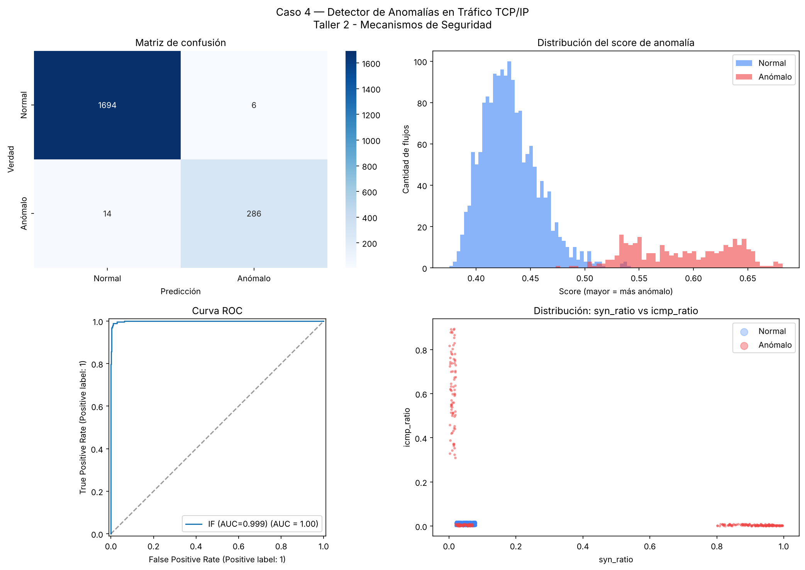

| | Predicho normal | Predicho anómalo |
|---|---|---|
| **Real normal** (1 700) | 1 694 | 6 (0,4 %) |
| **Real anómalo** (300) | 14 (4,7 %) | 286 |

Precisión 0,98 · recall 0,95 · F1 0,97 · AUC‑ROC 0,999 (Isolation Forest, 200 árboles, `contamination=0.15`).

### Comparación con una línea base estadística y separación temporal

La guía pide comparar contra una línea base y separar entrenamiento y evaluación por tiempo. El script original usa una partición aleatoria estratificada, así que se añadió `comparar_linea_base.py`: entrena con el primer 80 % de los flujos en orden y evalúa con el último 20 %, y enfrenta el modelo a un z‑score robusto (mediana y MAD; alerta si alguna característica supera |z| > 3,5).


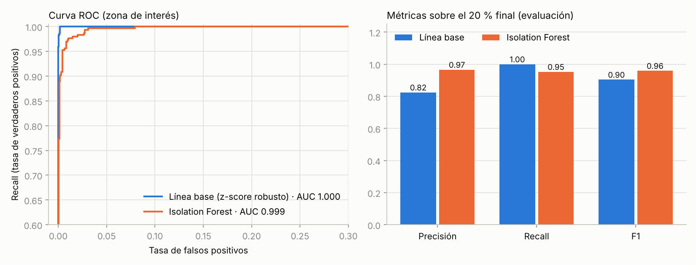

| Detector | TP | FP | FN | Precisión | Recall | F1 | Falsos positivos |
|---|---|---|---|---|---|---|---|
| Línea base (z‑score robusto) | 296 | 63 | 0 | 0,825 | 1,000 | 0,904 | 3,70 % |
| Isolation Forest | 282 | 10 | 14 | 0,966 | 0,953 | 0,959 | 0,59 % |

Lectura honesta del resultado:

- La línea base **no pierde ningún ataque**, pero genera seis veces más falsos positivos (63 frente a 10). En un SOC eso se traduce en carga de trabajo.
- Isolation Forest falla sobre todo en **túnel DNS** (recall 0,83): ese patrón solo se aparta en una de siete características, y el bosque de aislamiento lo confunde con tráfico normal.
- Que un umbral simple alcance recall 1,0 indica que **el conjunto sintético es demasiado fácil**. Con tráfico real las clases se solapan y ambas cifras bajarán.
- `contamination=0.15` coincide con la proporción real de anómalos del conjunto, un dato que en operación no se conoce. Es una ventaja artificial que debe declararse.

**Ejemplos anonimizados.** Las diez alertas de mayor score del script son flujos con `icmp_ratio` entre 0,57 y 0,89 y `bytes_pkt` entre 1 220 y 1 460: el patrón del Caso 7. Los flujos no contienen direcciones ni datos personales.

### Mitigación y uso responsable

- El score ordena la cola de revisión; ninguna acción de bloqueo depende solo de él.
- Reentrenar con ventanas deslizantes y vigilar la deriva (cambio en la distribución de características y en la tasa de alertas).
- Proteger los datos de entrenamiento: quien pueda inyectar tráfico durante el entrenamiento puede enseñar al modelo a considerar normal un ataque.
- Registrar la versión del modelo, la semilla y los hiperparámetros junto a cada alerta.

### Preguntas de análisis

**¿Cómo afectan el desbalance de clases y los cambios legítimos de carga?** Con 15 % de anómalos el problema es manejable; en una red real la proporción suele ser muy inferior al 1 %, y entonces incluso una tasa de falsos positivos del 0,6 % produce más alertas falsas que verdaderas. Los cambios legítimos (respaldos nocturnos, despliegues, inicio de semestre) desplazan la línea base y el modelo los marca como anómalos hasta que se reentrena; por eso la evaluación debe hacerse por tiempo y no con partición aleatoria.

**¿Qué métrica es más útil para el caso?** No la exactitud: con clases desbalanceadas, predecir siempre «normal» ya da una exactitud alta. Para un detector que alimenta a analistas importan el **recall** (ataques que no se pierden) y la **precisión** (alertas que valen el tiempo del analista), leídas juntas o resumidas en F1 o en el área bajo la curva precisión‑recall. La comparación anterior lo ilustra: la línea base gana en recall y pierde en precisión; cuál conviene depende de cuántas alertas puede revisar el equipo.

## Caso 5 — TCP: resets inesperados e indicios de inyección o desincronización

<span class="tag pcap">PCAP SINTÉTICA</span> <span class="tag real">ANÁLISIS REAL</span>

| Campo | Registro |
|---|---|
| **Identificador** | CASO‑05‑EV‑001 |
| **Fecha/hora** | Tiempo relativo de la PCAP: t = 0 a 6 869 s (1 h 54 min). Archivo generado el 2026‑11‑16 (UTC‑5) |
| **Origen/destino** | 192.168.50.10 (puertos efímeros) ↔ 192.168.50.20:443/TCP; RST con IP y MAC de 192.168.50.1 |
| **Observación** | 234 sesiones: handshake completo, cero bytes de datos, y un RST entre 28,0 y 30,0 s después (media 29,07 s). Ningún cierre con FIN |
| **Hipótesis** | El gateway elimina conexiones inactivas al vencer un timeout de estado cercano a 30 s y lo notifica con RST |
| **Alternativas** | Benignas: reinicio del servicio, balanceador, cliente que aborta. Maliciosa: inyección de RST por un tercero en el camino |
| **Validación** | `tcp.flags.reset == 1` → 234; todos con MAC origen `02:aa:00:00:00:01` (gateway), distinta de la del servidor; número de secuencia válido en los 234 |
| **Severidad** | Media: afecta disponibilidad de sesiones largas; sin indicio de manipulación |
| **Acción** | Revisar el timeout de estado TCP del gateway y habilitar keep‑alive en la aplicación; confirmar en el log del firewall |
| **Integridad** | `caso5_tcpreset_lab.pcap` · 65 544 bytes · SHA‑256 `7e31f67e737c3975484219f31067952f278369c5a9ea1123a5439a938ecdecbb` |

### Procedimiento y evidencia

```
tcp.flags.reset == 1                              todos los RST
tcp.flags.reset == 1 && eth.src == 02:aa:00:00:00:01     RST emitidos por el gateway
tcp.flags.fin == 1                                cierres ordenados (ninguno)
tcp.stream eq 0                                   seguir una sesión completa
Statistics > Conversations > TCP                  duración y bytes por flujo
```


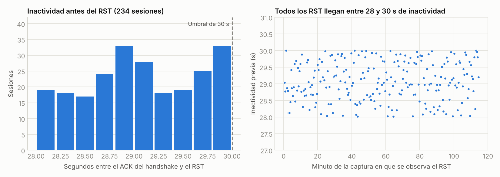

**Lo que la evidencia permite afirmar**

- El patrón es **regular y dependiente del tiempo**: todos los RST llegan justo antes de 30 s de inactividad y ninguna sesión transporta datos. Eso es lo esperable de una tabla de estados con timeout, no de un atacante, que cortaría sesiones activas.
- El emisor está **identificado en capa 2**: la MAC de origen de los RST es la del gateway, no la del servidor.
- No hay **ningún dato adicional** (logs del firewall, Zeek, aplicación) dentro de la evidencia. La causa «timeout de estado» es la hipótesis más consistente, pero queda por confirmar con el log del gateway.

**Limitación de la PCAP sintética.** Los RST llevan como IP de origen 192.168.50.1. En una red real, un firewall que corta una sesión falsifica la dirección del servidor para que el cliente acepte el RST; en ese caso la IP no delata al emisor, y serían la MAC de origen, el TTL y el IP ID los que lo distinguirían del servidor verdadero.

### Regla de detección propuesta (Suricata)

```
alert tcp any any -> $HOME_NET any (msg:"LAB-05 Rafaga de RST hacia un mismo host";
    flags:R; flow:stateless;
    threshold:type both, track by_dst, count 20, seconds 60;
    classtype:protocol-command-decode; sid:9000004; rev:2;)
```

En la captura los RST llegan a razón de uno cada 29 s, así que esta regla no se dispararía: es coherente con la conclusión de causa benigna. La regla busca ráfagas, que son el patrón de una inyección activa.

### Mitigación

- Ajustar el timeout de conexiones establecidas del gateway a un valor acorde con la aplicación y activar keep‑alive TCP o de aplicación por debajo de ese valor.
- Mantener TLS con validación de certificado: un RST inyectado puede cortar la sesión, pero no leerla ni alterarla.
- Segmentar la red y proteger la capa 2 (inspección ARP dinámica, port security) para dificultar que un tercero se ubique en el camino.
- IDS en el segmento interno con registro de RST por flujo.

### Preguntas de análisis

**¿Qué causas benignas generan RST?** Conexión a un puerto cerrado; aplicación que cierra un socket con datos sin leer o que termina de forma abrupta; reinicio de un servicio o de un host que pierde el estado de sus conexiones; timeout de inactividad en firewalls, NAT y balanceadores; cierre abortivo deliberado para liberar recursos; y respuestas a segmentos fuera de ventana.

**¿Qué evidencia adicional haría más sólida la hipótesis de manipulación?** RST que interrumpen sesiones **activas** y no inactivas; TTL, IP ID o MAC de origen distintos de los del extremo legítimo; el extremo supuestamente emisor que sigue enviando datos después de «su» RST; varios RST con números de secuencia consecutivos que tantean la ventana; cambios en la tabla ARP o ARP gratuitos cerca del evento; capturas simultáneas en ambos extremos donde el RST aparece en uno y no sale del otro; y selectividad por destino o por contenido.

## Caso 6 — UDP: reflexión y amplificación DNS, NTP o SSDP

<span class="tag sim">ESCENARIO SIMULADO</span>

La guía prohíbe generar tráfico de amplificación, y para este caso no se construyó PCAP: se trabaja con contadores simulados y con revisión de configuración.

| Campo | Registro |
|---|---|
| **Identificador** | CASO‑06‑EV‑001 |
| **Fecha/hora** | Escenario simulado, sin marca temporal real |
| **Origen/destino** | Servidor DNS 192.168.50.53 (UDP/53) y servicio NTP (UDP/123) como posibles reflectores; víctima simulada 192.168.50.99 |
| **Observación** | Respuesta DNS de 1 680 bytes a una consulta de 60 bytes (factor 28). El resolver acepta recursión desde cualquier origen y el NTP responde a `monlist` |
| **Hipótesis** | Los servicios propios pueden ser usados como reflectores si alguien falsifica la IP de la víctima como origen |
| **Alternativas benignas** | Respuestas grandes legítimas (DNSSEC, zonas con muchos registros); ráfaga de consultas de clientes propios |
| **Validación** | Revisión de `named.conf.options` y `ntp.conf` del escenario; las comprobaciones `dig` y `ntpq` se documentan como procedimiento, no se ejecutaron |
| **Severidad** | Alta: la infraestructura propia participaría en un ataque contra terceros |
| **Acción** | Restringir recursión, limitar tasa de respuestas, deshabilitar `monlist`, filtrado anti‑spoofing |
| **Integridad** | `caso6_fig1_reflexion_amplificacion.png` y `caso6_fig2_bind_config.png` (hashes en el índice) |

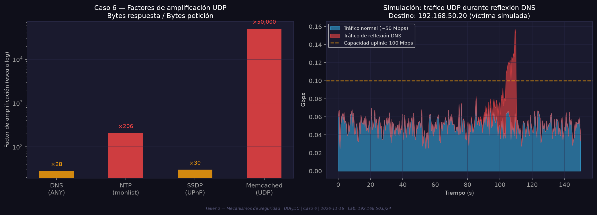

**Factores de amplificación de referencia**

| Protocolo | Puerto | Factor aproximado | Condición que lo permite |
|---|---|---|---|
| DNS | UDP/53 | 28 a 54 | Resolver abierto con recursión |
| NTP (`monlist`) | UDP/123 | 200 a más de 500 | ntpd anterior a 4.2.7p26 con `monlist` activo |
| SSDP | UDP/1900 | Alrededor de 30 | UPnP expuesto |
| Memcached | UDP/11211 | 10 000 a 50 000 | Servicio accesible por UDP sin restricción |

Los rangos son los que publica CISA/US‑CERT en la alerta TA14‑017A; el factor depende del tamaño de la respuesta que cada servidor pueda producir.

**Comprobación de que los servicios propios no son reflectores** (para ejecutar solo contra servidores propios):

```
dig @192.168.50.53 example.com A +norecurse       debe responder solo zonas propias
dig @192.168.50.53 . ANY                          no debe devolver respuestas grandes a externos
ntpq -c rv 192.168.50.53                          versión de ntpd
ntpdc -n -c monlist 192.168.50.53                 debe agotar el tiempo o ser rechazado
```

### Mitigación

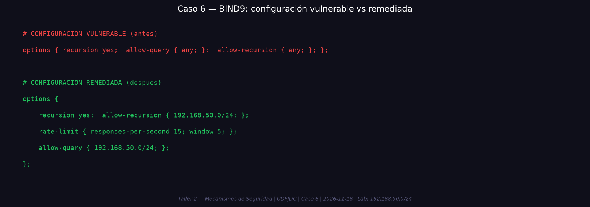

```
// named.conf.options
options {
    recursion yes;
    allow-recursion   { 192.168.50.0/24; };     // recursión solo para la LAN
    allow-query-cache { 192.168.50.0/24; };
    rate-limit { responses-per-second 15; window 5; };
};
```

```
# /etc/ntp.conf
restrict default kod nomodify notrap nopeer noquery
restrict -6 default kod nomodify notrap nopeer noquery
disable monitor
```

**Regla de detección propuesta**

```
alert udp $HOME_NET 53 -> any any (msg:"LAB-06 Respuestas DNS grandes en rafaga hacia un destino";
    dsize:>1000; threshold:type both, track by_dst, count 100, seconds 10;
    classtype:attempted-dos; sid:9000007; rev:1;)
```

### Preguntas de análisis

**¿Cómo se diferencia una ráfaga legítima de un patrón de reflexión?** En tráfico legítimo, cada respuesta corresponde a una consulta previa del mismo cliente y el volumen de ambos sentidos guarda proporción. En reflexión, el destino recibe respuestas que nunca pidió; los bytes de respuesta superan por mucho a los de consulta; las consultas se repiten (mismo nombre, tipo ANY o registros grandes); y desde la víctima se ven muchos servidores distintos respondiendo a la vez desde el mismo puerto de origen (53, 123, 1900).

**¿Qué controles corresponden al servidor y cuáles al proveedor de red?** Al administrador del servidor: no ofrecer recursión a desconocidos, limitar la tasa de respuestas, deshabilitar funciones amplificadoras y apagar servicios UDP innecesarios. Al proveedor u operador de la red: filtrado de direcciones de origen en el borde (BCP 38 / uRPF), que es lo único que impide la falsificación, y mitigación volumétrica aguas arriba. La víctima no puede resolver sola un ataque que satura su enlace.

## Caso 7 — ICMP: escaneo, payloads atípicos y posible túnel

<span class="tag pcap">PCAP SINTÉTICA</span> <span class="tag real">ANÁLISIS REAL</span>

| Campo | Registro |
|---|---|
| **Identificador** | CASO‑07‑EV‑001 |
| **Fecha/hora** | Tiempo relativo de la PCAP: t = 0 a 452,3 s (7,5 min). Archivo generado el 2026‑11‑16 (UTC‑5) |
| **Origen/destino** | 192.168.50.100 → 192.168.50.20, ICMP tipo 8 código 0, identificador 0x1337 |
| **Observación** | 3 375 Echo Request (448 por minuto), todos con 1 472 bytes de datos (paquete IP de 1 500 bytes). Cero Echo Reply. Cada paquete repite un único byte cuyo valor es el número de secuencia módulo 256 |
| **Hipótesis** | Tráfico ICMP generado por herramienta: inundación o prueba de carga al límite de la MTU |
| **Alternativas** | Benignas: prueba de MTU (`ping -f -l 1472`), monitoreo mal configurado. Maliciosa: túnel ICMP |
| **Validación** | `icmp.type == 8 && data.len > 100` → 3 375. Entropía por paquete 0,00 bits/byte; patrón byte = seq mod 256 en los 3 375 paquetes |
| **Severidad** | Media: volumen anómalo desde un host no inventariado; la evidencia **no** respalda transporte de datos ocultos |
| **Acción** | Identificar 192.168.50.100; limitar tasa y tamaño de ICMP hacia servidores |
| **Integridad** | `caso7_icmp_lab.pcap` · 5 163 774 bytes · SHA‑256 `318601c9070ecd4928e5424e2d721e42737c4013a95c2f0fe30621843244f93b` |

### Procedimiento y evidencia

```
icmp                                              todo ICMP
icmp.type == 8                                    Echo Request
icmp.type == 0                                    Echo Reply (ninguno)
icmp.type == 8 && data.len > 100                  payload mayor al de un ping normal
Statistics > Endpoints / I/O Graphs               volumen por IP y por minuto
```


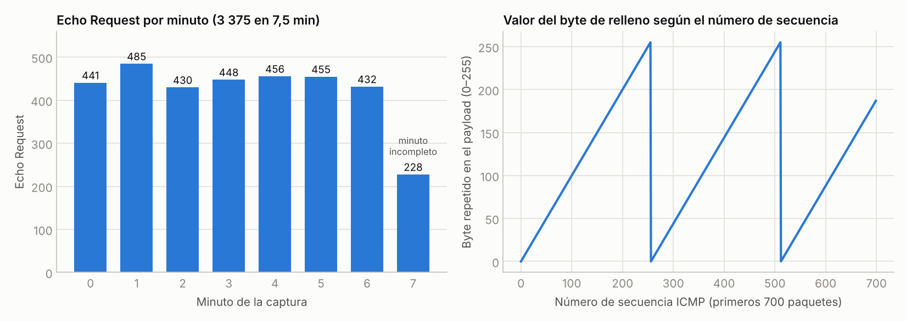

**Tabla de tamaños y frecuencias**

| Origen | Echo Request | Echo Reply | Payload | Tasa | Intervalo medio |
|---|---|---|---|---|---|
| 192.168.50.100 (analizado) | 3 375 | 0 | 1 472 bytes (100 %) | 448/min | 134 ms, irregular |
| Referencia: `ping` de Windows | 4 por ejecución | 4 | 32 bytes | 60/min | 1 000 ms |

**Interpretación.** El volumen (unas siete veces la tasa de un ping continuo, sostenida durante 7,5 minutos) y el tamaño (46 veces el de un ping de Windows, el máximo que cabe sin fragmentar) son anómalos. En cambio, la hipótesis de túnel **no se sostiene** con esta captura: un túnel transporta datos de usuario, que producen entropía alta dentro de cada paquete; aquí cada paquete es un único byte repetido 1 472 veces (entropía 0) y el valor es un simple contador. La entropía de 8 bits/byte que resulta de juntar todos los paquetes se debe solo a que el contador recorre los 256 valores. Tampoco hay respuestas, de modo que no existe canal de retorno. La lectura más consistente es una inundación o prueba de carga unidireccional.

### Regla de detección propuesta (Suricata)

```
alert icmp any any -> $HOME_NET any (msg:"LAB-07 ICMP Echo grande y frecuente";
    itype:8; dsize:>100;
    threshold:type both, track by_src, count 50, seconds 60;
    classtype:misc-activity; sid:9000005; rev:2;)
```

Un ping normal (32 o 56 bytes) nunca cumple `dsize:>100`, y una prueba de MTU puntual no llega a 50 paquetes por minuto.

### Mitigación

- Permitir hacia los servidores solo los tipos ICMP necesarios: Echo (8/0) con límite de tasa, Destination Unreachable (3, incluido el código 4 «fragmentación necesaria») y Time Exceeded (11).
- Limitar el tamaño de Echo Request aceptado desde redes de usuario.
- Inventariar el origen: en Windows, `arp -a` y la tabla del switch para ubicar la MAC `02:bb:00:00:01:00`.
- Monitorizar volumen de ICMP por host en lugar de bloquearlo en bloque.

### Preguntas de análisis

**¿Qué funciones legítimas cumple ICMP?** Diagnóstico de alcance y latencia (Echo); notificación de errores de entrega (Destination Unreachable); descubrimiento de la MTU del camino (tipo 3 código 4); detección de bucles y `traceroute` (Time Exceeded); y, en IPv6, funciones imprescindibles como descubrimiento de vecinos y de routers (ICMPv6).

**¿Qué impacto tendría bloquearlo completamente?** Se rompe el descubrimiento de MTU: las conexiones se establecen pero se quedan colgadas al enviar paquetes grandes, un fallo difícil de diagnosticar. Las aplicaciones dejan de recibir errores inmediatos y esperan hasta agotar el tiempo. Se pierde `ping` y `traceroute` para operación. En IPv6 la red deja de funcionar. Por eso el control correcto es filtrar por tipo y limitar la tasa.

## Caso 8 — Escaneo de puertos y fingerprinting de servicios

<span class="tag pcap">PCAP SINTÉTICA</span> <span class="tag real">ANÁLISIS REAL</span>

| Campo | Registro |
|---|---|
| **Identificador** | CASO‑08‑EV‑001 |
| **Fecha/hora** | Tiempo relativo de la PCAP: t = 0 a 29,95 s. Archivo generado el 2026‑11‑16 (UTC‑5) |
| **Origen/destino** | 192.168.50.100 → 192.168.50.20, puertos TCP 1 a 65 535 |
| **Observación** | 65 535 SYN, uno por puerto, en orden ascendente y con intervalo constante de 457 µs (2 188 puertos/s). Respuestas: 65 528 RST/ACK y 7 SYN/ACK. El origen nunca completa el handshake |
| **Hipótesis** | Escaneo SYN (semiabierto) de todo el rango de puertos, previo a un reconocimiento de servicios |
| **Alternativas benignas** | Escáner de vulnerabilidades autorizado, inventario de activos, monitoreo no notificado |
| **Validación** | `tcp.flags.syn == 1 && tcp.flags.ack == 0` → 65 535; `tcp.flags.syn == 1 && tcp.flags.ack == 1` → 7 |
| **Severidad** | Media: reconocimiento completo; revela el mapa de servicios del servidor |
| **Acción** | Verificar si el escaneo estaba autorizado; identificar el host; reducir la superficie expuesta |
| **Integridad** | `caso8_portscan_lab.pcap` · 9 174 924 bytes · SHA‑256 `f0f0436c39121ac1b459674f70e2faaf5d7273366627d56911429acba7bd28b0` |

### Procedimiento y evidencia

```
tcp.flags.syn == 1 && tcp.flags.ack == 0          sondeos
tcp.flags.syn == 1 && tcp.flags.ack == 1          puertos abiertos
tcp.flags.reset == 1 && tcp.flags.ack == 1        puertos cerrados
Statistics > Conversations > TCP                  un flujo por puerto
```


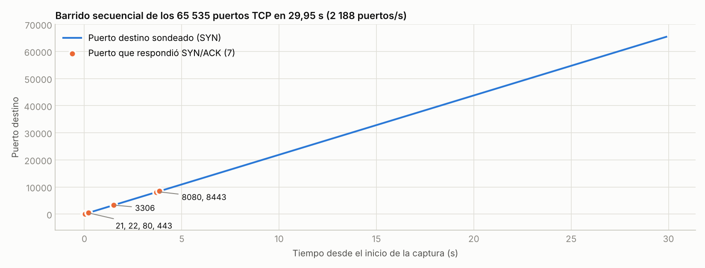

**Lista de exposición del servidor** (puertos que respondieron SYN/ACK)

| Puerto | Servicio esperado | Necesario | Acción |
|---|---|---|---|
| 21 | FTP | No | Cerrar; SFTP sobre el 22 |
| 22 | SSH | Sí | Restringir por origen; llaves en lugar de contraseña |
| 80 | HTTP | Sí | Redirigir a HTTPS |
| 443 | HTTPS | Sí | Mantener actualizado |
| 3306 | MySQL | Solo local | Ligar a 127.0.0.1 |
| 8080 | HTTP alterno | No documentado | Cerrar o autenticar |
| 8443 | HTTPS alterno | No documentado | Cerrar o restringir |

El servicio se infiere del número de puerto. **La captura no contiene banners ni datos de aplicación** (el origen no completa ninguna conexión), así que no hay evidencia de versiones ni de huella de sistema operativo: los SYN no llevan opciones TCP, que es lo que se usa para ese tipo de huella. Las versiones del Caso 3 pertenecen al escenario simulado, no a esta PCAP.

**Indicadores observados**

- Un solo origen contacta 65 535 puertos distintos de un mismo destino en 30 s.
- 99,99 % de los intentos van a puertos cerrados.
- Orden estrictamente secuencial e intervalo sin variación: firma de herramienta automática. Los escáneres habituales aleatorizan el orden de los puertos; un barrido 1, 2, 3… es más fácil de detectar.
- Ninguna conexión se completa después del SYN/ACK.

### Regla de detección propuesta (Suricata)

```
alert tcp any any -> $HOME_NET any (msg:"LAB-08 Posible escaneo SYN: muchos intentos desde un origen";
    flags:S,12; flow:stateless;
    threshold:type both, track by_src, count 100, seconds 10;
    classtype:attempted-recon; sid:9000006; rev:2;)
```

El umbral cuenta SYN por origen. Una detección más precisa cuenta **puertos destino distintos** por origen, que es lo que hace el script `policy/misc/scan` de Zeek. Para el monitoreo autorizado se añade una supresión explícita:

```
suppress gen_id 1, sig_id 9000006, track by_src, ip 192.168.50.10
```

### Plan de endurecimiento

1. Cerrar 21, 8080 y 8443 si no tienen responsable; MySQL solo en loopback.
2. Firewall del servidor con política de entrada «denegar por defecto» y permitidos 22, 80 y 443 por origen.
3. Descartar en silencio (DROP) en el perímetro para que el escaneo sea más lento y menos informativo.
4. Bloqueo temporal del origen tras la alerta, con revisión humana y lista de excepciones.
5. Escaneo propio periódico y autorizado para comparar contra esta lista de exposición.

### Preguntas de análisis

**¿Qué limitaciones tiene atribuir un escaneo a una sola IP?** La dirección identifica una interfaz, no a una persona: puede ser un equipo comprometido usado como pivote, una salida de NAT, VPN o proxy compartida por muchos usuarios, o una dirección reasignada por DHCP. En un escaneo SYN el origen necesita ver las respuestas, así que la IP no suele ser falsa, pero puede haber señuelos mezclados. Un escaneo distribuido reparte los puertos entre muchas IP para no superar umbrales. La atribución requiere correlacionar con DHCP, tabla ARP/MAC del switch, autenticación de red y registros del propio host.

**¿Cómo se reducen falsos positivos por monitoreo autorizado?** Con un inventario de escáneres autorizados (IP, ventana horaria, responsable); supresiones por origen para esas IP, nunca globales; anuncio de las ventanas de escaneo en el SIEM; y revisión periódica de las excepciones. Una alerta de escaneo desde una IP autorizada fuera de su ventana sigue siendo una alerta.

## Caso 9 — Priorización y correlación de alertas con IA y SIEM

<span class="tag sim">ESCENARIO SIMULADO</span>

| Campo | Registro |
|---|---|
| **Identificador** | CASO‑09‑EV‑001 |
| **Fecha/hora** | Escenario simulado de una sesión de monitoreo de 6 horas |
| **Origen/destino** | Cinco fuentes: Suricata (127 alertas), firewall (342), DNS (89), Zeek conn.log (1 204), eventos de Windows (547) |
| **Observación** | 2 309 eventos brutos; tras normalizar y eliminar duplicados quedan 847; agrupados por host y ventana de tiempo forman 23 incidentes (3 críticos, 7 altos, 13 medios) |
| **Hipótesis** | La mayoría de las alertas describe la misma actividad vista por varias fuentes; un solo host (192.168.50.100) concentra los incidentes críticos |
| **Alternativas benignas** | Reglas ruidosas, escáner autorizado, cambios de configuración que disparan varias fuentes a la vez |
| **Validación** | Diseño del pipeline y criterios de prioridad; los conteos son sintéticos |
| **Severidad** | Media |
| **Acción** | Escalar los incidentes críticos y altos a revisión humana; ningún bloqueo automático |
| **Integridad** | `caso9_fig1_correlacion_alertas.png` y `caso9_fig2_pipeline.png` (hashes en el índice) |

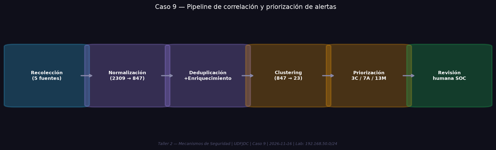

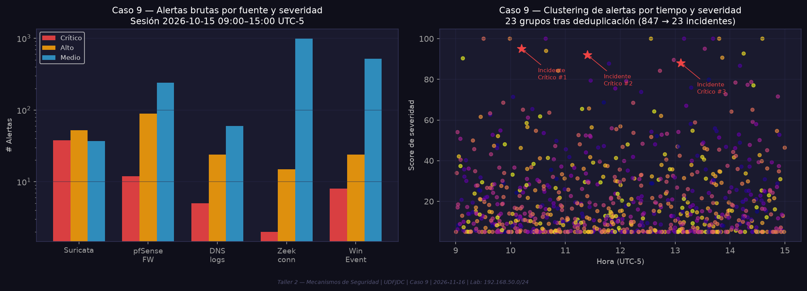

### Etapas del pipeline

| Etapa | Qué hace | Cómo conserva la trazabilidad |
|---|---|---|
| Recolección | Recibe EVE JSON de Suricata, syslog del firewall, querylog de DNS, logs de Zeek y eventos de Windows | Guarda el evento original con su hash |
| Normalización | Unifica marca de tiempo (ISO 8601, UTC), IP, puerto, protocolo y tipo de evento | Mantiene el identificador de la fuente |
| Deduplicación | Agrupa eventos con igual origen, destino, tipo y ventana de 60 s | Conserva el conteo y la lista de eventos originales |
| Enriquecimiento | Añade criticidad del activo, propietario, si la IP es interna y si pertenece a un escáner autorizado | Campos añadidos marcados como derivados |
| Agrupación | Reúne eventos por host y ventana temporal; un detector de anomalías sobre conteos por host señala desviaciones | El incidente referencia todos sus eventos |
| Priorización | Calcula un score explicable | Guarda los factores del score |
| Revisión humana | El analista confirma, descarta o escala | Registro de la decisión, con responsable y hora |

### Criterios de prioridad

`score = 40 × (severidad máxima / 5) + 30 × (criticidad del activo / 5) + 30 × (fuentes que coinciden / 3, con tope en 1)`. El resultado va de 0 a 100 y cada sumando se guarda con la alerta.

| Nivel | Score | Criterio | Respuesta |
|---|---|---|---|
| Crítico | 85 o más | Tres o más fuentes coinciden sobre un activo crítico con severidad máxima | Revisión inmediata; contención decidida por una persona |
| Alto | 65–84 | Dos fuentes coinciden o hay un servicio expuesto involucrado | Investigar en menos de 1 h |
| Medio | 40–64 | Una fuente con indicador moderado | Revisar en el turno |
| Bajo | Menos de 40 | Evento aislado o telemetría de fondo | Registrar y observar tendencia |

### Ejemplo de alerta enriquecida

Construida con los hallazgos medidos en los Casos 7 y 8:

```json
{
  "incidente": "INC-2026-0007",
  "host_origen": "HOST_A (192.168.50.100, no inventariado)",
  "activo_destino": "SRV_WEB (192.168.50.20, criticidad 4/5)",
  "ventana": "t0 a t0 + 8 min",
  "eventos": [
    {"fuente": "IDS", "regla": "LAB-08 Posible escaneo SYN", "detalle": "65 535 puertos en 29,95 s; 7 abiertos"},
    {"fuente": "IDS", "regla": "LAB-07 ICMP Echo grande y frecuente", "detalle": "3 375 Echo Request de 1 472 bytes"},
    {"fuente": "firewall", "detalle": "conexiones nuevas desde HOST_A fuera de la línea base"}
  ],
  "score": 76,
  "nivel": "Alto",
  "factores": {"severidad_max": "4/5 -> 32", "criticidad_activo": "4/5 -> 24", "fuentes": "2/3 -> 20"},
  "contexto": {"host_no_inventariado": true},
  "hipotesis": "Reconocimiento seguido de inundación ICMP desde un mismo host",
  "alternativas_benignas": ["Escáner autorizado no registrado", "Prueba de carga"],
  "accion_sugerida": "Identificar HOST_A por MAC y puerto de switch; confirmar autorización",
  "requiere_validacion_humana": true
}
```

### Registro de validación humana

| Incidente | Decisión del analista | Evidencia consultada | Resultado |
|---|---|---|---|
| INC‑2026‑0007 | Confirmado como reconocimiento; no bloquear aún | PCAP de los Casos 7 y 8; inventario | Escalar a red para ubicar el host |
| INC‑2026‑0003 | Descartado | Ventana de respaldo programada | Añadir excepción documentada |
| INC‑2026‑0011 | Requiere más datos | Solo una fuente | Activar registro adicional 24 h |

El registro es un ejemplo del formato; las decisiones son ilustrativas.

### Uso de un LLM en el triage

- Solo recibe alertas **anonimizadas** (seudónimos como `HOST_A`), nunca capturas, credenciales ni datos personales.
- Se usa para resumir y proponer preguntas de investigación; no decide ni ejecuta acciones.
- Toda afirmación del resumen se verifica contra el evento original antes de usarse; lo que no se pueda verificar se descarta.
- El contenido de los logs es dato no confiable: un atacante puede escribir texto en un campo (un User‑Agent, un nombre de host) para manipular el resumen. El modelo no debe tener permisos de acción.
- Se registra qué modelo y qué instrucción produjeron cada resumen.

### Preguntas de análisis

**¿Cómo explicar una alerta a un analista?** Con los hechos primero y la interpretación después: qué se observó, entre qué equipos, cuándo y durante cuánto tiempo; cuánto se aparta de la línea base y en qué atributos; qué fuentes coinciden; qué factores componen el score; qué explicaciones benignas existen; y qué comprobación concreta confirma o descarta la hipótesis. Un score sin sus factores no es una explicación.

**¿Qué riesgo supone automatizar bloqueos basados solo en una puntuación?** Bloquear un activo legítimo y causar la indisponibilidad que se quería evitar; que un atacante provoque bloqueos a voluntad falsificando el origen (denegación de servicio autoinducida); que aprenda el umbral y opere por debajo; que la deriva del modelo dispare bloqueos masivos tras un cambio legítimo; y que no quede claro quién responde por la decisión. Por eso el bloqueo automático se reserva a reglas deterministas de alta confianza, con duración limitada y reversión sencilla.

## Caso 10 — Mensajería XMPP: interceptación y errores de TLS

<span class="tag sim">ESCENARIO SIMULADO</span>

No se instaló un servidor XMPP. El caso se resuelve como auditoría de una configuración simulada de Openfire 4.6.0, y deja documentado el procedimiento para repetirla sobre un servidor real.

| Campo | Registro |
|---|---|
| **Identificador** | CASO‑10‑EV‑001 |
| **Fecha/hora** | Escenario simulado, sin marca temporal real |
| **Origen/destino** | Clientes XMPP → 192.168.50.30, puertos 5222 (cliente‑servidor), 5269 (servidor‑servidor), 9090/9091 (consola) |
| **Observación** | TLS 1.0 habilitado; certificado autofirmado y vencido; suites RC4 y 3DES disponibles; STARTTLS opcional; consola de administración por HTTP en el 9090; SASL PLAIN permitido sin TLS |
| **Hipótesis** | Configuración inicial nunca endurecida; un atacante en el camino podría forzar una negociación débil o capturar credenciales |
| **Alternativas benignas** | Compatibilidad con clientes antiguos; entorno de pruebas sin datos reales |
| **Validación** | Lista de verificación TLS; comandos de comprobación documentados, no ejecutados |
| **Severidad** | Alta: confidencialidad de mensajes y credenciales |
| **Acción** | Exigir TLS 1.2 o superior, renovar el certificado, cerrar la consola HTTP, autenticación SCRAM |
| **Integridad** | `caso10_fig1_tls_analisis.png` (hash en el índice) |

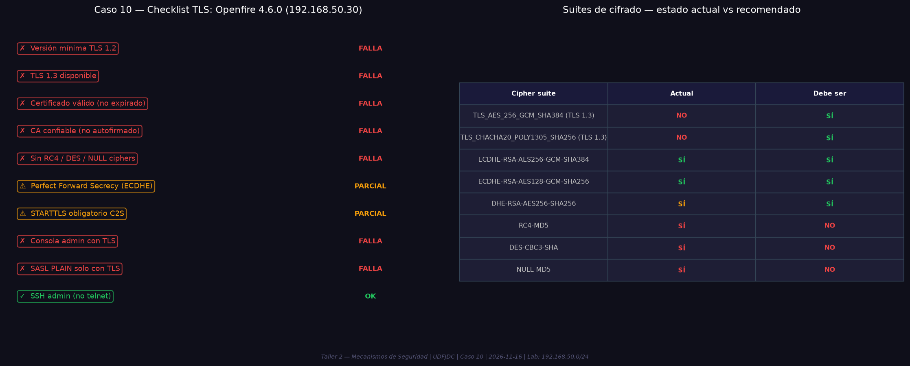

### Lista de verificación TLS

| Control | Estado en el escenario | Riesgo |
|---|---|---|
| Versión mínima TLS 1.2 | Falla: acepta TLS 1.0 | Protocolos obsoletos (RFC 8996) |
| TLS 1.3 disponible | Falla | Sin las mejoras de privacidad y rendimiento |
| Certificado vigente | Falla: vencido | Los clientes aprenden a ignorar advertencias |
| Cadena de confianza | Falla: autofirmado | No hay forma de distinguirlo de un impostor |
| Nombre del certificado coincide con el dominio XMPP | Por verificar | Suplantación |
| Solo suites AEAD con secreto perfecto hacia adelante | Falla: RC4 y 3DES presentes | Cifrados rotos (RFC 7465) |
| STARTTLS obligatorio | Parcial: opcional | Ataque de degradación eliminando STARTTLS |
| SASL sin PLAIN fuera de TLS | Falla | Credenciales en claro |
| Consola de administración solo por HTTPS y red de gestión | Falla: HTTP en 9090 | Captura de la sesión de administrador |
| Cifrado de extremo a extremo disponible (OMEMO) | No evaluado | El servidor ve el contenido |

### Procedimiento de verificación sobre un servidor real

```
openssl s_client -connect 192.168.50.30:5222 -starttls xmpp -xmpphost lab.internal
openssl s_client -connect 192.168.50.30:5222 -starttls xmpp -tls1      debe fallar
openssl x509 -noout -subject -issuer -dates -ext subjectAltName         sobre el certificado recibido
```

En Wireshark, con `tcp.port == 5222`, una sesión bien protegida muestra `<starttls/>` en claro y, a continuación, solo registros TLS (`tls.record.content_type == 23`, datos de aplicación). Si después de la negociación siguen viéndose etiquetas `<message>` o `<auth mechanism="PLAIN">`, la sesión no está cifrada. Los metadatos (direcciones, puertos, horas, tamaños) quedan visibles en ambos casos.

### Plan de corrección

| Prioridad | Acción |
|---|---|
| Inmediata | Cerrar el puerto 9090 y dejar la consola solo en 9091 (HTTPS), accesible desde la red de gestión |
| Inmediata | Política de seguridad del cliente en «requerida» (STARTTLS obligatorio); deshabilitar SASL PLAIN sin TLS |
| 24 h | Emitir un certificado válido (CA interna para `lab.internal`) con el nombre correcto y renovación automática |
| 24 h | Deshabilitar TLS 1.0 y 1.1; permitir solo TLS 1.2 y 1.3 con suites AEAD (AES‑GCM, ChaCha20‑Poly1305) |
| 1 semana | Actualizar Openfire a la versión estable vigente; SCRAM‑SHA‑256 como mecanismo de autenticación |
| Según modelo de amenaza | Habilitar OMEMO en los clientes para cifrado de extremo a extremo |

### Preguntas de análisis

**¿Qué protege TLS y qué no protege?** Protege la confidencialidad y la integridad de los datos en tránsito entre dos puntos y autentica al servidor (y al cliente, si se usan certificados de cliente). No protege los metadatos (quién se comunica con quién, cuándo y cuánto), los datos una vez descifrados en el servidor o en los equipos de los usuarios, los registros e historiales almacenados, ni sirve de nada si el cliente acepta certificados inválidos.

**¿En qué se diferencia el cifrado de transporte del cifrado de extremo a extremo?** El cifrado de transporte protege cada tramo: cliente‑servidor y servidor‑servidor. El servidor descifra, procesa y vuelve a cifrar, así que el administrador o quien comprometa el servidor puede leer los mensajes. En el cifrado de extremo a extremo (OMEMO en XMPP) las claves solo existen en los dispositivos de los interlocutores; el servidor transporta contenido que no puede leer. Son complementarios: TLS protege credenciales y metadatos del tramo, y el extremo a extremo protege el contenido frente al propio servidor.

## Conclusiones de la Parte I

1. **Un indicador aislado no confirma un ataque.** En el Caso 5, 234 RST parecían una manipulación y el patrón temporal apunta a un timeout del gateway. En el Caso 7, el volumen de ICMP sugería un túnel y el contenido de los paquetes lo descarta.
2. **Medir sobre la evidencia corrige las suposiciones.** Recalcular cada cifra a partir de las PCAP obligó a retirar tres afirmaciones que el archivo no respaldaba. El script de análisis y los hashes permiten que cualquiera repita la comprobación.
3. **Los controles básicos son los que más riesgo reducen.** Cerrar servicios sin responsable, ligar a loopback lo que es local, cifrar y actualizar. El inventario real del equipo analista mostró que incluso un computador de trabajo tiene 16 puertos escuchando en todas las interfaces.
4. **El aprendizaje automático ayuda a priorizar, no a decidir.** Isolation Forest redujo seis veces los falsos positivos frente a un umbral estadístico, pero perdió el 17 % de los túneles DNS, y ambos resultados provienen de datos sintéticos fáciles.
5. **Límites de este trabajo.** No hubo red de laboratorio física ni sensores desplegados: las reglas de detección no se probaron en un IDS, las mitigaciones no se verificaron con un antes y un después, y los Casos 3 (segunda parte), 6, 9 y 10 se apoyan en telemetría simulada.

**Oportunidades de mejora priorizadas:** montar la topología en máquinas virtuales aisladas y capturar tráfico propio; ejecutar las reglas con `suricata -r <pcap>` y registrar qué alertas se disparan; repetir el Caso 4 con flujos extraídos de capturas reales; y auditar un servidor XMPP real con el procedimiento del Caso 10.

# Parte II — Sistema de rastreo de ubicación por consentimiento

<span class="tag real">CÓDIGO Y PRUEBAS REALES</span>

## Enfoque

Ninguna técnica legítima permite ubicar un teléfono a partir de su número sin la cooperación del titular o de la operadora. WhatsApp y Telegram no exponen la ubicación de sus usuarios a terceros; solo la comparten cuando el propio usuario la envía. El sistema se diseñó en consecuencia: **solo registra la ubicación que el titular del número envía voluntariamente**, después de aceptar el consentimiento y verificar el número con un código de un solo uso, y le permite pausar el rastreo o borrar sus datos en cualquier momento.

Casos de uso previstos: compartir ubicación entre familiares, seguimiento de flotas con conocimiento del conductor, acompañamiento de trayectos.

## Arquitectura

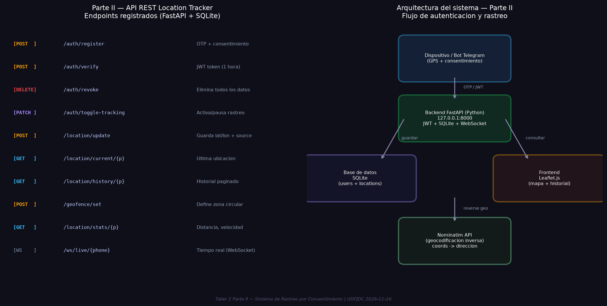

| Componente | Archivo | Tecnología | Función |
|---|---|---|---|
| Backend | `parte2/backend/main.py` | FastAPI, JWT (HS256), WebSocket | Registro, verificación, recepción y consulta de ubicaciones |
| Datos | `parte2/backend/database.py` | SQLAlchemy sobre SQLite | Tablas `users` y `location_records` |
| Panel web | `parte2/frontend/index.html` | Leaflet y OpenStreetMap | Mapa, última ubicación, historial y trazado de ruta |
| Bot | `parte2/telegram_bot/bot.py` | python‑telegram‑bot | Consentimiento, verificación y envío de ubicación desde Telegram |

## Flujo de uso

1. El usuario acepta el consentimiento y registra su número (`POST /auth/register`). El backend guarda la fecha de aceptación y genera un OTP de seis dígitos con vigencia de 10 minutos.
2. Verifica el OTP (`POST /auth/verify`) y recibe un token JWT válido por 60 minutos.
3. Envía su ubicación (`POST /location/update`) desde el bot, con el botón «Compartir mi ubicación», o desde cualquier cliente con el token.
4. El panel consulta la última posición y el historial, dibuja el recorrido y recibe actualizaciones por WebSocket.
5. El usuario puede pausar el rastreo (`PATCH /auth/toggle-tracking`) o revocar el consentimiento y borrar todo (`DELETE /auth/revoke`).

## Evidencia de funcionamiento

**Prueba de la API** ejecutada en el equipo local (127.0.0.1:8000) el 2026‑11‑16 a las 21:50 (UTC‑5), con el número de demostración +57 300 123 4567:

| # | Petición | Resultado |
|---|---|---|
| 1 | `POST /auth/register` | OTP generado: 679470 |
| 2 | `POST /auth/verify` | Token JWT emitido |
| 3 | `POST /location/update` (2 veces) | Registros 1 y 2 creados |
| 4 | `GET /location/current/{phone}` | lat 4,615, lon −74,075 |
| 5 | `GET /location/stats/{phone}` | 2 registros, 0,948 km |
| 6 | `GET /location/history/{phone}` | 2 registros |
| 7 | `POST /geofence/set` | Zona 4,6097, −74,0817, radio 500 m |
| 8 | `PATCH /auth/toggle-tracking?enabled=false` | Rastreo pausado |

La base de datos que dejó esa prueba confirma cada paso: un usuario verificado, con fecha de consentimiento, OTP ya consumido, rastreo pausado, zona definida y dos ubicaciones almacenadas (las horas de la base están en UTC).


## Cobertura de requisitos

| Requisito de la guía | Estado | Cómo se cumple o qué falta |
|---|---|---|
| Registro por número telefónico | Cumplido (demo) | Registro con OTP. El código se devuelve en la respuesta en lugar de enviarse por SMS |
| Solicitud y captura de ubicación | Cumplido | El usuario la envía desde el bot de Telegram o por la API |
| Actualización periódica | Parcial | La API acepta envíos sucesivos y el panel se actualiza por WebSocket; falta el cliente móvil que envíe cada N minutos |
| Visualización en mapa | Cumplido | Leaflet con OpenStreetMap; marcador y polilínea del recorrido |
| Geocodificación inversa | Cumplido | Consulta a Nominatim desde el panel |
| Alertas por zona (opcional) | Parcial | La zona se guarda con `/geofence/set`; falta evaluar entrada y salida y notificar |
| Historial de ubicaciones | Cumplido | Paginado con `limit` y `offset`; falta filtro por fecha |
| Acceso seguro | Parcial | OTP y JWT; ver hallazgos de seguridad |
| Bot de Telegram | Cumplido | Solicita contacto y ubicación con botones; no rastrea sin acción del usuario |
| Estadísticas de recorrido (opcional) | Cumplido | Distancia (Haversine), duración y velocidad media |
| Aplicación móvil Android/iOS | No implementado | El bot de Telegram cumple el papel de cliente en el dispositivo |

## Revisión de seguridad del prototipo

Aplicando al propio sistema los criterios de la Parte I, la revisión del código encontró estos puntos. Se documentan como trabajo pendiente antes de cualquier uso fuera del laboratorio.

| # | Hallazgo | Riesgo | Corrección propuesta |
|---|---|---|---|
| 1 | `GET /location/current`, `/history` y `/stats` aceptan cualquier número: basta un token válido propio para consultar la ubicación de otro usuario | **Alto.** Rompe el modelo de consentimiento | Autorizar solo al titular o a quienes él haya aprobado de forma explícita (tabla de permisos por observador) |
| 2 | El WebSocket `/ws/live/{phone}` no pide autenticación | **Alto.** Cualquiera puede suscribirse a las actualizaciones de un número | Exigir el token al conectar y aplicar la misma autorización |
| 3 | El OTP se devuelve en la respuesta y se guarda en claro; se genera con `random` | Medio. Aceptable solo en demostración | Enviar por SMS, guardar solo el hash, generar con `secrets` y limitar intentos |
| 4 | `SECRET_KEY` con valor por defecto en el código | Medio. Permite falsificar tokens si no se configura | Exigir la variable de entorno y fallar al arrancar si falta |
| 5 | CORS con `allow_origins=["*"]` y credenciales | Medio | Lista de orígenes permitidos |
| 6 | Sin límite de tasa en registro y verificación | Medio. Fuerza bruta de un OTP de seis dígitos | Límite por número y por IP; bloqueo temporal |
| 7 | El panel envía las coordenadas a Nominatim y carga teselas de OpenStreetMap | Bajo. Terceros reciben coordenadas | Informarlo en el consentimiento o usar un geocodificador propio |
| 8 | Sin TLS en el entorno local | Bajo en laboratorio | Proxy inverso con HTTPS en cualquier despliegue |

## Privacidad y marco legal

- El consentimiento queda registrado con fecha y hora y es requisito para crear la cuenta.
- El titular puede pausar el rastreo y ejercer la supresión completa de sus datos.
- En Colombia, la ubicación de una persona es un dato personal protegido por la Ley 1581 de 2012: su tratamiento exige autorización previa, expresa e informada, finalidad definida y la posibilidad de revocarla. Rastrear a alguien sin su conocimiento queda fuera del alcance de este sistema y de la guía.
- Mientras el hallazgo 1 no se corrija, el prototipo debe usarse únicamente con números de prueba.

# Índice de evidencias e integridad

Todos los archivos están en la carpeta `evidencias/`. Los hashes se calcularon con SHA‑256 sobre los archivos originales y pueden verificarse con `python analizar_pcaps.py hashes` o, en PowerShell, con `Get-FileHash -Algorithm SHA256 evidencias\*`.

| Archivo | Tipo | Bytes | SHA‑256 |
|---|---|---|---|
| `cap_caso1_analisis_pcap.png` | Captura | 450 988 | <span class="hash">7ee21fdcdfc8f98cacc0442042c3b59a0847b5943300bfef9e9d2ab61d39a29c</span> |
| `cap_caso2_analisis_pcap.png` | Captura | 413 370 | <span class="hash">e4d2e3a34bd208ae9b5d5aa821a18697d8fe5e9014a03a8de873e9f8478e8408</span> |
| `cap_caso3_netstat_equipo_real.png` | Captura | 253 719 | <span class="hash">87615f970132e4512979680954dc588695476abfc59ccc83d86f00a81468454e</span> |
| `cap_caso4_comparacion_linea_base.png` | Captura | 140 209 | <span class="hash">f897c2ab41a89bce829897f2cf0ec63f82770382a2a539a7fe769b2bfdfd235f</span> |
| `cap_caso4_ejecucion_iforest.png` | Captura | 227 650 | <span class="hash">2d7b64614a28a3344e0dead37d3f67a1d0cf4293ccf9bd1d0480bfb8586baeec</span> |
| `cap_caso5_analisis_pcap.png` | Captura | 441 687 | <span class="hash">fd173c307c33fd5d3b50541749a57e5bd70c6a9f3d7ca97af7f616613595efca</span> |
| `cap_caso7_analisis_pcap.png` | Captura | 416 025 | <span class="hash">79447f7fde8bcc05c1f08a616936d8c41d30845467959a8fa6ae3c2d3304c986</span> |
| `cap_caso8_analisis_pcap.png` | Captura | 436 048 | <span class="hash">d2d106463eb98652f3c70eb3538d44d58780bddc02c322dbf33361927d0f118e</span> |
| `cap_parte2_base_datos.png` | Captura | 134 411 | <span class="hash">24006b07d29036b1ffc306a429ab6ecbd43d6b300f73968a119bbaf87ac60860</span> |
| `cap_parte2_frontend_panel.png` | Captura | 165 640 | <span class="hash">9475ed7c68af600d93a01b72639c8d2158776f8147b0098f357588e9a0265c3d</span> |
| `caso10_fig1_tls_analisis.png` | Figura de escenario | 140 982 | <span class="hash">88acdf2e4469c8e126a4583b5320ff0da48c591bf22f1b3aa18e253baed46842</span> |
| `caso1_fig1_syn_temporal_topsources.png` | Figura de escenario | 140 222 | <span class="hash">be49b0bcc6b90b43eba92fc0afa000e34993881b2e834283c7a23f22f6c98124</span> |
| `caso1_fig2_netstat_estados.png` | Figura de escenario | 69 748 | <span class="hash">03ed80a02e7d04e9acbb5f078681e4993f980220adb05845e20af9f1a5169b91</span> |
| `caso1_fig3_pcap_syn_por_segundo.png` | Figura calculada | 87 765 | <span class="hash">f822357b383b074f6c54218415c1256a0e0f904b221dffa2049e243998c7fc94</span> |
| `caso1_synflood_lab.pcap` | PCAP sintética | 272 254 | <span class="hash">a28678760a655d13945d1588ac033784193b2fca43c886bf448af85eb6d31950</span> |
| `caso2_dnstunnel_lab.pcap` | PCAP sintética | 115 640 | <span class="hash">df946077e9557e9255c5b36b5f48d56dc203e542d488b1e1a107e529fbdb97f6</span> |
| `caso2_fig1_dns_analisis.png` | Figura de escenario | 124 317 | <span class="hash">ba24c6d66d4af2f306f62838142fe859f463683219544b6edcbb26bcfd7fe1fc</span> |
| `caso2_fig2_tabla_dominios.png` | Figura de escenario | 81 600 | <span class="hash">47976ef7dcf49dc5ff35658160f81706a54f440aec2427c6de9df2c7d3f2179b</span> |
| `caso2_fig3_pcap_dns_tasa_entropia.png` | Figura calculada | 83 356 | <span class="hash">380f2e214516b4e2abd4129a9757b5a8dca81da227cd1e3f2dfd36f69ee8353e</span> |
| `caso3_fig1_riesgo_inventario.png` | Figura de escenario | 156 404 | <span class="hash">fe069ad64c7a9f5b18190b35fadb68538bc3797ee6a120fe5e1c1256b5e4c875</span> |
| `caso3_fig2_auth_log.png` | Figura de escenario | 98 688 | <span class="hash">17f1c3f7e4f33f1c825f66d2b0fa9412ccef5dedebce0d94cb44c4acd0504dae</span> |
| `caso4_fig1_resultados_iforest.png` | Figura calculada | 182 113 | <span class="hash">ac89d8a6e261246158f955ea7d43411a1c80e94bd8c28441cca771d050267dc6</span> |
| `caso4_fig2_comparacion_linea_base.png` | Figura calculada | 94 742 | <span class="hash">1bc47cfe49120e958964a65d14f97f6756155524cfa673d8a073027ef43c006e</span> |
| `caso4_ml_resultados.png` | Figura calculada | 175 161 | <span class="hash">e3e4849a5d68eebfdb1b5cc9e328308aa2688428463a89cdc84f001fcc337cc4</span> |
| `caso5_fig1_rst_analisis.png` | Figura de escenario | 144 382 | <span class="hash">d0f04c314837cf1ed8d1835446ce42aa783db8ba0102bdf14786953c9cd4c5ed</span> |
| `caso5_fig2_pcap_rst_inactividad.png` | Figura calculada | 101 328 | <span class="hash">4bc2a82162040714de36e91a44f16ef6f51c3eb76f8d58af5474e403835b72a7</span> |
| `caso5_tcpreset_lab.pcap` | PCAP sintética | 65 544 | <span class="hash">7e31f67e737c3975484219f31067952f278369c5a9ea1123a5439a938ecdecbb</span> |
| `caso6_fig1_reflexion_amplificacion.png` | Figura de escenario | 183 934 | <span class="hash">14e5ce4f3b0d4993d36138d705aa01e2e666a07988299698c06c7cf4d4b05ecf</span> |
| `caso6_fig2_bind_config.png` | Figura de escenario | 57 979 | <span class="hash">7f137c72948f8e8d703940f2dc70997050f646244775b3d09846d34301f9adde</span> |
| `caso7_fig1_icmp_analisis.png` | Figura de escenario | 112 705 | <span class="hash">a1d994f43b177e57e4639554077e9204ec120425c0666fc3a2bfbd58d8d6959d</span> |
| `caso7_fig2_pcap_icmp_tasa_patron.png` | Figura calculada | 107 071 | <span class="hash">e011b40b078be63c865dde5367fb0ac8c9be4d1b96bfa9f23ad844760fa7f126</span> |
| `caso7_icmp_lab.pcap` | PCAP sintética | 5 163 774 | <span class="hash">318601c9070ecd4928e5424e2d721e42737c4013a95c2f0fe30621843244f93b</span> |
| `caso8_fig1_scan_puertos.png` | Figura de escenario | 141 872 | <span class="hash">e2e1b9c1a8e11e27fff52edc94d21fbe9c7bdca5e4ade284f8abe96cb268b776</span> |
| `caso8_fig2_pcap_barrido_puertos.png` | Figura calculada | 93 364 | <span class="hash">f444895376bf9c3ebb2a63f857f4622f18495db31e2e50c74df2773ad6d32151</span> |
| `caso8_portscan_lab.pcap` | PCAP sintética | 9 174 924 | <span class="hash">f0f0436c39121ac1b459674f70e2faaf5d7273366627d56911429acba7bd28b0</span> |
| `caso9_fig1_correlacion_alertas.png` | Figura de escenario | 297 379 | <span class="hash">292fc05152cba03e6b35cfd4a8422bce70db721ee4836edcf68a710f9c2904d1</span> |
| `caso9_fig2_pipeline.png` | Figura de escenario | 60 455 | <span class="hash">0ece8e2286dcdd8d194290cca2b71654d070c692b0bb3cdafd4a1066df954517</span> |
| `parte2_sistema_funcionando.png` | Figura de escenario | 167 659 | <span class="hash">8b587cfc0e2abcd9435772bd158e164ac28e991220c5f6fe3f9556d438a03d18</span> |
| `sistema_netstat.txt` | Salida real | 12 812 | <span class="hash">d534d1689ed80d315c102e797ef7d49d0a6b16022ea7ec2bf30762094594a586</span> |
| `sistema_netstat_captura.png` | Captura real | 134 685 | <span class="hash">9a179bdd1e6f6694202a9996712e5512fd52153debea0f19767f7e436aaea477</span> |

Las figuras `caso1_fig1`, `caso1_fig2`, `caso2_fig1`, `caso2_fig2`, `caso5_fig1`, `caso7_fig1` y `caso8_fig1` de la versión anterior se conservan en la carpeta, pero ya no se citan: mostraban valores de escenario que no coincidían con las PCAP y fueron reemplazadas por las figuras calculadas sobre las capturas.

# Referencias

- RFC 9293, *Transmission Control Protocol* (estados de conexión y RST); RFC 4987, *TCP SYN Flooding Attacks and Common Mitigations*.
- RFC 1035, *Domain Names: Implementation and Specification*; RFC 792, *Internet Control Message Protocol*.
- BCP 38 / RFC 2827, *Network Ingress Filtering*; CISA, alerta TA14‑017A, *UDP‑Based Amplification Attacks*.
- RFC 6120, *XMPP: Core*; RFC 8996, *Deprecating TLS 1.0 and TLS 1.1*; RFC 7465, *Prohibiting RC4 Cipher Suites*; XEP‑0384, *OMEMO Encryption*.
- Liu, Ting y Zhou (2008), *Isolation Forest*, IEEE ICDM.
- Documentación de Suricata (reglas y `threshold`), Zeek (framework de avisos) y Wireshark (filtros de visualización).
- Ley 1581 de 2012 (Colombia), protección de datos personales.
